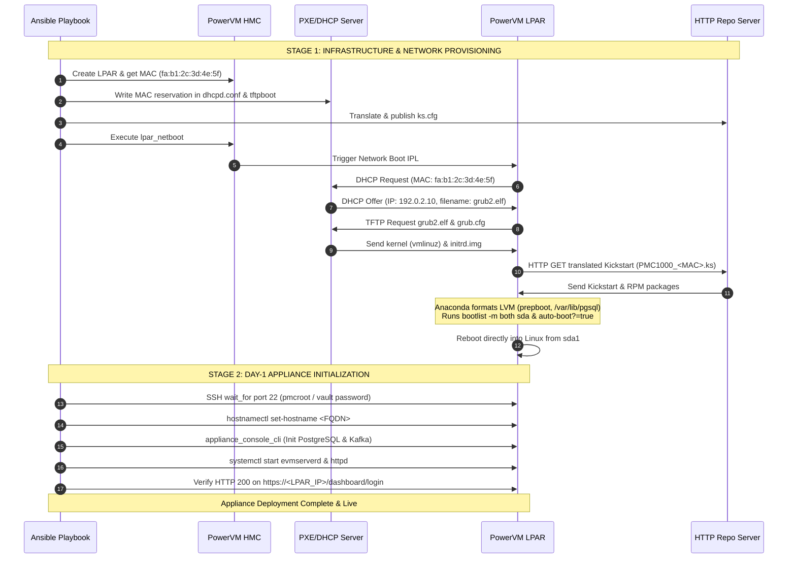

# IBM Power Mission Control (PMC) PAO Appliance Network Installation (`pmc_pao_install`)

This document provides a comprehensive technical breakdown of the end-to-end automated network deployment of the **IBM Power Mission Control (PMC) PAO appliance** on **IBM PowerVM LPARs** using the Ansible role [`ibm.power_hmc.pmc_pao_install`](ansible-power-hmc/roles/pmc_pao_install/).

---

## Table of Contents
1. [End-to-End Network Boot & Deployment Lifecycle](#1-end-to-end-network-boot--deployment-lifecycle)
2. [Phase-by-Phase Boot Sequence Breakdown](#2-phase-by-phase-boot-sequence-breakdown)
   - [Phase 1: Partition Activation & BOOTP/DHCP Handshake](#phase-1-partition-activation--bootpdhcp-handshake)
   - [Phase 2: TFTP Bootloader & Kernel Delivery (MAC-Isolated)](#phase-2-tftp-bootloader--kernel-delivery-mac-isolated)
   - [Phase 3: Kernel Initialization & Anaconda Kickstart Acquisition](#phase-3-kernel-initialization--anaconda-kickstart-acquisition)
3. [Dynamic ISO Kickstart Adaptation & On-the-Fly Translation](#3-dynamic-iso-kickstart-adaptation--on-the-fly-translation)
   - [Preserving Vendor Disk Geometry (prepboot & /var/lib/pgsql)](#preserving-vendor-disk-geometry-prepboot---size8-and-varlibpgsql)
   - [Dynamic Repository URL Translation](#dynamic-repository-url-translation)
   - [Open Firmware Bootlist & NVRAM Auto-Boot Persistence](#open-firmware-bootlist--nvram-auto-boot-persistence-sms-menu-resolution)
   - [Headless Serial Console Sanitization (/dev/hvc0 vs /dev/tty3)](#headless-serial-console-sanitization-devhvc0-vs-devtty3)
4. [User Authentication & Security Baseline](#4-user-authentication--security-baseline)
5. [Day-1 Appliance Initialization (Stage 2 Architecture)](#5-day-1-appliance-initialization-stage-2-architecture)
6. [Summary Workflow Diagram](#6-summary-workflow-diagram)

---

## 1. End-to-End Network Boot & Deployment Lifecycle

```
┌───────────────────────────────────────────────────────────────────────────────────────────────────┐
│                                       ORCHESTRATION LAYER                                         │
│  Ansible Controller ───> HMC (powervm_lpar_instance) ───> PXE/DHCP Server ───> HTTP Repo Server   │
└─────────────────────────────────┬─────────────────────────────────────────────────────────────────┘
                                  │
                                  ▼
┌───────────────────────────────────────────────────────────────────────────────────────────────────┐
│                                   POWERVM FIRMWARE & OS DEPLOYMENT                                │
│                                                                                                   │
│  1. HMC lpar_netboot             2. DHCP / BOOTP Handshake          3. TFTP Bootloader & Kernel   │
│  ┌─────────────────────────┐     ┌────────────────────────────┐     ┌──────────────────────────┐  │
│  │ Hypervisor powers on    │────>│ Open Firmware broadcasts   │────>│ Downloads grub2.elf,     │  │
│  │ LPAR in netboot IPL mode│     │ MAC: fa:b1:2c:3d:4e:5f     │     │ grub.cfg, vmlinuz, and   │  │
│  └─────────────────────────┘     │ dhcpd returns IP & TFTP IP │     │ initrd.img               │  │
│                                  └────────────────────────────┘     └─────────────┬────────────┘  │
│                                                                                   │               │
│                                                                                   ▼               │
│  6. Stage 2 Appliance Init       5. Reboot to Linux Disk            4. Anaconda OS Installation   │
│  ┌─────────────────────────┐     ┌────────────────────────────┐     ┌──────────────────────────┐  │
│  │ Ansible connects via    │<────│ Open Firmware reads NVRAM  │<────│ Fetches translated ks.cfg│  │
│  │ SSH under pmcroot       │     │ bootlist pointing to sda1  │     │ Formats LVM filesystems  │  │
│  │ Runs appliance_console  │     │ Boots directly into GRUB2  │     │ Installs RPM packages    │  │
│  │ Web UI live on port 443 │     │ (No SMS menu interruption) │     │ Writes bootlist to NVRAM │  │
│  └─────────────────────────┘     └────────────────────────────┘     └──────────────────────────┘  │
└───────────────────────────────────────────────────────────────────────────────────────────────────┘
```

---

## 2. Phase-by-Phase Boot Sequence Breakdown

### Phase 1: Partition Activation & BOOTP/DHCP Handshake

1. **HMC LPAR Instance Creation**:
   The `powervm_lpar_instance` module creates or updates the target LPAR with the desired vCPU, RAM, virtual SCSI storage, and virtual Ethernet adapter.
2. **MAC Address Discovery**:
   The role queries the HMC partition facts to extract the exact Virtual Ethernet MAC address (e.g., `fa:b1:2c:3d:4e:5f`) assigned to the network interface.
3. **DHCP Reservation Setup**:
   On the PXE server, the role writes a temporary host reservation block into `/etc/dhcp/dhcpd.conf`:
   ```text
   host lpar_target {
       hardware ethernet fa:b1:2c:3d:4e:5f;
       fixed-address 192.0.2.10;
       next-server 192.0.2.5;
       filename "fa-b1-2c-3d-4e-5f/ppc/ppc64/grub2.elf";
   }
   ```
4. **Triggering `lpar_netboot`**:
   The HMC initiates a network IPL session via the HMC REST API / CLI (`lpar_netboot -t ent -s auto -d auto ...`).
5. **BOOTP/DHCP Request**:
   The LPAR's Open Firmware powers on with no OS in RAM. It broadcasts a BOOTP/DHCP packet across the virtual switch.
   - The DHCP server inspects the packet header.
   - Matching the MAC `fa:b1:2c:3d:4e:5f`, `dhcpd` replies with:
     - Assigned IP: `192.0.2.10`
     - TFTP Server (`next-server`): `192.0.2.5`
     - Bootloader Binary (`filename`): `fa-b1-2c-3d-4e-5f/ppc/ppc64/grub2.elf`

---

### Phase 2: TFTP Bootloader & Kernel Delivery (MAC-Isolated)

To allow multiple concurrent deployments on the same network without conflict, all TFTP assets are strictly isolated in directories named after the client MAC address:

```text
/var/lib/tftpboot/fa-b1-2c-3d-4e-5f/
├── grub.cfg
└── ppc/
    └── ppc64/
        ├── grub2.elf
        ├── vmlinuz
        └── initrd.img
```

1. **Downloading GRUB2 (`grub2.elf`)**:
   Open Firmware issues a TFTP Read Request (`RRQ`) for `fa-b1-2c-3d-4e-5f/ppc/ppc64/grub2.elf`, loads it into memory, and executes GRUB2.
2. **Loading Client Configuration (`grub.cfg`)**:
   GRUB2 detects its boot root as `(tftp,192.0.2.5)/fa-b1-2c-3d-4e-5f/` and reads its dedicated configuration file generated by [`templates/grub_conf.j2`](ansible-power-hmc/roles/pmc_pao_install/templates/grub_conf.j2:1):
   ```text
   set timeout=1
   menuentry 'Install OS' {
       insmod http
       insmod tftp
       set root=tftp,192.0.2.5
       echo 'Loading OS Install kernel ...'
       linux fa-b1-2c-3d-4e-5f/ppc/ppc64/vmlinuz \
             ifname=net0:fa:b1:2c:3d:4e:5f \
             ip=192.0.2.10::192.0.2.1:255.255.255.0:pmc-lpar.example.com:net0:none \
             nameserver=192.0.2.2 \
             inst.repo=http://192.0.2.5:80/repo/pmc-ppc64le/ \
             inst.ks=http://192.0.2.5:80/PMC1000_fa:b1:2c:3d:4e:5f.ks
       initrd fa-b1-2c-3d-4e-5f/ppc/ppc64/initrd.img
   }
   ```
3. **Downloading Kernel & Initramfs**:
   GRUB2 downloads the 64-bit PowerPC Linux kernel (`vmlinuz`) and Anaconda initial RAM disk (`initrd.img`) over TFTP.
4. **Execution Handoff to Linux Kernel**:
   GRUB passes hardware control to the Linux kernel along with the Dracut command-line arguments.

---

### Phase 3: Kernel Initialization & Anaconda Kickstart Acquisition

1. **Dracut Device Binding (`ifname=net0:<MAC>`)**:
   The kernel maps the virtual network card with MAC `fa:b1:2c:3d:4e:5f` specifically to network interface name `net0`.
2. **Static Network Activation**:
   Dracut configures static IP routing immediately in installer memory using `ip=192.0.2.10::192.0.2.1...`, bypassing further DHCP requests.
3. **Kickstart Download**:
   Anaconda issues an HTTP GET to `http://192.0.2.5/PMC1000_fa:b1:2c:3d:4e:5f.ks` to fetch the fully translated Kickstart installation file.
4. **DHCP Cleanup on PXE Host**:
   Once the kernel and initrd have been transferred, the Ansible role deletes the temporary DHCP host entry from `/etc/dhcp/dhcpd.conf` and restarts `dhcpd` so the address reservation is freed.

---

## 3. Dynamic ISO Kickstart Adaptation & On-the-Fly Translation

The PMC appliance ISO ships its own Kickstart configuration (`ks.cfg`) containing complex LVM volume layouts, PostgreSQL database mounts, RSCT cluster packages, and container runtimes.

The `pmc_pao_install` role fetches the ISO `ks.cfg` (and fails if it is missing), then translates it on-the-fly:

```
┌────────────────────────────────────────────────────────┐
│ Original ISO Kickstart (base-iso.ks.erb)               │
│ • Optical media: cdrom & file:///run/install/repo/...  │
│ • Local network: network --bootproto=dhcp              │
│ • GUI TTY switches: exec < /dev/tty3, chvt 3           │
│ • Default NVRAM: BOOT_DEVICE=$(nvram --print-config)   │
└───────────────────────────┬────────────────────────────┘
                            │
                            │ Dynamic Translation Pipeline (tasks/main.yml)
                            ▼
┌────────────────────────────────────────────────────────┐
│ Translated Netboot Kickstart (PMC1000_<MAC>.ks)       │
│ • Network media: url --url="http://<repo>/BaseOS"      │
│ • Static network: network --bootproto=static --ip=...  │
│ • Headless serial: Neutralized /dev/tty3 redirects    │
│ • PAPR NVRAM Bootlist: bootlist -m both sda            │
│ • Preserved Disk Layout: prepboot, /var/lib/pgsql, LVM │
└────────────────────────────────────────────────────────┘
```

---

### Preserving Vendor Disk Geometry (`prepboot --size=8` and `/var/lib/pgsql`)

PowerPC PowerVM partitions require a specialized disk partition topology:

```text
bootloader --location=mbr --append="crashkernel=auto rhgb quiet console=ttyS0,115200 console=tty0"
zerombr
clearpart --all --initlabel

# PReP Boot Partition: Required for ppc64le Open Firmware (8MB raw partition)
part prepboot         --size=8     --fstype=prepboot
part /boot            --size=1024  --fstype=xfs
part /var/www/miq_tmp --size=10240 --fstype=xfs --fsoptions="rw,noatime"
part pv.1             --size=1     --grow

volgroup vg_system           --pesize=4096 pv.1
logvol /                     --name=lv_os             --vgname=vg_system --percent=10 --fstype=xfs
logvol /var                  --name=lv_var            --vgname=vg_system --percent=21 --fstype=xfs
logvol /var/lib/pgsql        --name=lv_pgsql          --vgname=vg_system --percent=32 --fstype=xfs
logvol /var/log              --name=lv_var_log        --vgname=vg_system --percent=14 --fstype=xfs
logvol /var/log/audit        --name=lv_var_log_audit  --vgname=vg_system --percent=1  --fstype=xfs
logvol /tmp                  --name=lv_tmp            --vgname=vg_system --percent=5  --fstype=xfs
logvol /home                 --name=lv_home           --vgname=vg_system --percent=2  --fstype=xfs
logvol swap                  --name=lv_swap           --vgname=vg_system --percent=4  --grow
```

1. **`prepboot --size=8` (Partition 1)**:
   PowerVM Open Firmware cannot read standard Linux filesystems (`ext4`/`xfs`) directly. The 8MB `prepboot` partition (PPC PReP type `0x41`) stores the raw GRUB2 ELF binary.
2. **`logvol /var/lib/pgsql`**:
   The internal PostgreSQL database engine mandates a dedicated filesystem on `/var/lib/pgsql`. Discarding this layout prevents the database from initializing.

---

### Dynamic Repository URL Translation

The role replaces all optical paths with HTTP endpoints:
```jinja2
# Converts local CD-ROM mount points to network HTTP URLs
_step_repos: "{{ _raw_ks | replace('file:///run/install/repo/', _repo_base ~ '/') | regex_replace('(?m)^[ \\t]*cdrom', 'url --url=\"' ~ _repo_base ~ '/BaseOS\"') }}"
```
This ensures BaseOS, AppStream, ManageIQ, EPEL, and RSCT repositories are fetched over the network during installation.

---

### Open Firmware Bootlist & NVRAM Auto-Boot Persistence (SMS Menu Resolution)

#### The Problem
During network installation, `lpar_netboot` temporarily sets the LPAR's active boot device in NVRAM to the **Network Adapter** (`/vdevice/l-lan@...`).
If the installer finishes and reboots without reconfiguring NVRAM:
- Open Firmware attempts to boot from the network card again.
- Because no active TFTP boot session is waiting, network boot fails and Open Firmware halts at the **SMS Menu** (`1 = SMS Menu, 5 = Default Boot List`).

#### The Solution: `bootlist -m both sda`
Inside the Kickstart `%post` section, the role writes:
```bash
%post
# 1. Ensure the NVRAM character device exists inside chroot
[ -c /dev/nvram ] || mknod /dev/nvram c 10 144 2>/dev/null || true
chmod 600 /dev/nvram 2>/dev/null || true

# 2. Write binary boot records for /dev/sda1 (prepboot) into both Normal and Service NVRAM slots
bootlist -m both sda || bootlist -m normal sda || true

# 3. Instruct Open Firmware to boot automatically on reboot
nvram --update-config "auto-boot?=true" 2>/dev/null || true
%end
```

- **`bootlist -m both sda`** queries `/dev/sda`, locates the 8MB `prepboot` partition (`/dev/sda1`), determines the exact Open Firmware device path (e.g. `/vdevice/v-scsi@30000003/disk@8100000000000000:1`), and writes the **binary boot records** to both the **Normal** and **Stored/Service** boot lists.
- On reboot, Open Firmware finds the valid bootloader on `sda1` and boots directly into Linux without stopping at the SMS menu.

---

### Headless Serial Console Sanitization (`/dev/hvc0` vs `/dev/tty3`)

The vendor ISO Kickstart was designed for x86 workstations with graphical screens, including virtual terminal switches:
```bash
exec < /dev/tty3
chvt 3
```

On PowerVM LPARs, the console is an **HMC virtual serial terminal (`/dev/hvc0`)**. `/dev/tty3` does not exist.
When Anaconda encountered `exec < /dev/tty3`, it hung indefinitely waiting for input on a non-existent terminal device.

The role translates these lines during Kickstart generation:
```jinja2
_step_console: "{{ _step_post | regex_replace('(?m)^[ \\t]*exec\\s*<\\s*/dev/tty\\d+.*$', '# exec < /dev/tty') | regex_replace('(?m)^[ \\t]*chvt\\s+\\d+.*$', '# chvt') | regex_replace('\\|\\s*tee\\s+/dev/tty\\d+', '') }}"
```
Post-installation scripts now execute and finish cleanly on the serial console.

---

## 4. User Authentication & Security Baseline

To comply with corporate security standards, the appliance ISO implements the following user model:

| User Account | Initial Status | Intended Role | Sudo Privilege |
|---|---|---|---|
| **`root`** | **Expired** by default (`passwd -e root`) | Superuser (requires password change on interactive console) | Direct root |
| **`pmcroot`** | **Active** (Password: set in the ISO; supplied to Ansible via the `PMC_PAO_PASSWORD` environment variable) | Official Appliance Operator / Automation Admin | **`ALL=(ALL) NOPASSWD: ALL`** |

### How Ansible Authenticates
Ansible connects to the newly installed LPAR as **`pmcroot`** using the password supplied through the `PMC_PAO_PASSWORD` environment variable with **`become: true`** (`NOPASSWD: ALL`). This:
1. Avoids SSH failures caused by the expired `root` account.
2. Leaves the product's default security model 100% intact.

---

## 5. Day-1 Appliance Initialization (Stage 2 Architecture)

The deployment is split into two independent, modular stages using Ansible tags:

```yaml
# Stage 1: PowerVM LPAR Infrastructure & Network Install (Tags: stage1, provision)
- name: Stage 1 - Deploy PMC PAO appliance LPAR via Network Netboot
  hosts: vm
  roles:
    - role: pmc_pao_install

# Stage 2: Official Appliance Initialization & Health Check (Tags: stage2, configure)
- name: Stage 2 - Post-Provisioning Appliance Initialization & Health Check
  hosts: vm
  gather_facts: false
  become: true
  vars:
    ansible_user: "pmcroot"
    ansible_password: "{{ lookup('ansible.builtin.env', 'PMC_PAO_PASSWORD') }}"
    ansible_python_interpreter: "/usr/bin/python3"
```

### Stage 2 Task Sequence (per IBM GA Installation Guide)

1. **Lightweight Socket Poll**:
   Uses `ansible.builtin.wait_for` on port 22 (allowing up to 2 hours) so Ansible does not leak open file descriptors while packages are installing.
2. **Hostname Configuration**:
   ```bash
   hostnamectl set-hostname <FQDN>
   ```
3. **Database Idempotency Check**:
   Checks for the existence of `/var/lib/pgsql/data/PG_VERSION`. If missing, executes the initial database setup.
4. **Official CLI Initialization**:
   ```bash
   source /etc/default/evm

   # Initialize PostgreSQL database (Region 0)
   appliance_console_cli --internal --region 0 --dbname vmdb_production --username root --password "{{ appliance_db_password }}"

   # Configure Kafka messaging broker
   appliance_console_cli --message-server-config --message-server-host localhost --message-server-port 9093 --message-keystore-username admin --message-keystore-password "{{ appliance_kafka_password }}"
   systemctl enable --now kafka.service

   # Start ManageIQ core processes & Apache
   appliance_console_cli --server=start
   systemctl enable --now evmserverd.service httpd.service
   ```
5. **Web Health Check**:
   Polls `https://<LPAR_IP>/dashboard/login?pmc_login_loader=1` on port 443 until HTTP 200 is returned.

---

## 6. Summary Workflow Diagram


